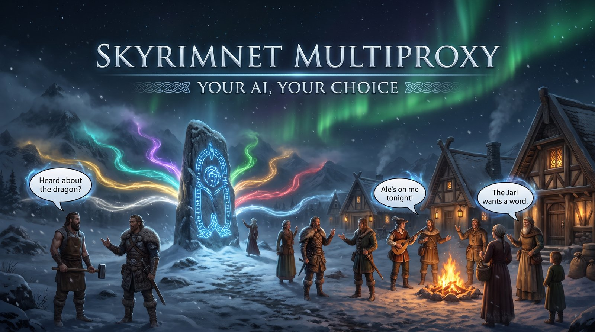

 

# SkyrimNet MultiProxy

> **Cloud or Local. Paid or Free. Any AI, Straight to SkyrimNet.**

---

## ⚡ Overview

[SkyrimNet](https://github.com/MinLL/SkyrimNet-GamePlugin) gives your NPCs AI dialogue. MultiProxy sits between the mod and the AI you choose, passing the conversations back and forth.

You decide where your NPCs get their dialogue:

- **Subscriptions (no API key needed):** Your existing Claude, ChatGPT, Google AI Pro, or SuperGrok account.
- **API keys:** GLM (z.ai), Nano-GPT, OpenAI, DeepSeek, Gemini, xAI, Continuum, Kilo Gateway, or TypeSafe, plus the small free allowances from Cloudflare Workers AI, Mistral, and Groq.
- **Your own hardware, free:** Models that MultiProxy runs on your graphics card, Ollama, LM Studio, or models on **another PC in your house**.

Mix and match as you like. You set everything up in your browser. You can paste keys, see what is active, and run a **Quick test** to make sure it all works. MultiProxy installs like a normal program, putting an icon by your clock.

MultiProxy is ready to run right out of the box. It builds on [galanx's original Claude-SkyrimNet-Proxy](https://github.com/galanx/Claude-SkyrimNet-Proxy) with extra features already added, so you do not need to install any patches. See Credits below.

### 📋 At a Glance

| Feature | Details |
| :--- | :--- |
| **Requirements** | Windows (Linux downloads are also available) and SkyrimNet. Python is built into the installer. You need at least one AI: a subscription, an API key, or a graphics card for local models |
| **Performance Impact** | Direct API calls after the first request (~2s), instead of ~9s per request via a subprocess |
| **Safety** | See the Terms of Service notice below before using this — read it in full |
| **Compatibility** | SkyrimNet (MinLL/SkyrimNet-GamePlugin), Windows |

---

## ✨ Key Features

### Run AI on your own hardware

* **Built-in local models:** Pick a model on the **Local models** tab and press Download. MultiProxy runs it on your graphics card. You need no separate program, no key, and no bill. A fit check shows how much graphics memory Skyrim and your models use, so the game always keeps enough room. Use it in SkyrimNet as `local/MODEL`.
* **Other devices and the Courier:** Put the small **MultiProxy Courier** on a spare PC or laptop, type its pairing code once, and use its models as `laptop/MODEL`. From your main PC, you can watch its graphics card, load and unload models, and download new ones. If a device drops out, MultiProxy moves on to your next choice.
* **The Courier updates itself:** When a new Courier comes with MultiProxy, an **Update Courier** button appears on the device and on the **Overview** page. If the new version fails to start, the device goes back to the old one by itself.
* **Quick decisions:** A small, free model answers the quick questions SkyrimNet asks all the time, like who speaks next. It runs on your PC or a spare one, and hands off to your other AIs if it is busy.
* **Higgs voice:** Your NPCs can speak out loud with a voice engine running on your own hardware. Each voice is copied from a short sample. You can also give any voice a clear clip of your own.
* **Speech to text:** Talk to your NPCs with SkyrimNet's push-to-talk key. MultiProxy sends a short recording of your voice to xAI, which turns it into text. This keeps your graphics card free for Skyrim and the voices. It is off until you turn it on, and it needs an xAI key with some credit.
* **Bring your own:** Do you already have a model file? Add it right where it sits. Ollama and LM Studio models show up too.

### Choose your AI

* **Subscription support:** Use the Claude, ChatGPT (Codex), Google AI Pro (Antigravity), or SuperGrok account you already pay for.
* **Key-based providers:** GLM, Nano-GPT, OpenAI, DeepSeek, Gemini, xAI, Continuum, Kilo Gateway, and TypeSafe, plus Cloudflare Workers AI, Mistral, and Groq for small free allowances. Type `provider/MODEL` in SkyrimNet (like `gemini/gemini-3.8-flash`). The dashboard lists the exact models your key allows, so you never have to guess a name.
* **Routing:** Pick which model answers Dialogue, Combat, Memory, and the other jobs. You can set backups if one fails. When you move a job, MultiProxy can ask if you want to keep the old model as a backup.
* **Model rotation:** Type several models separated by commas, and MultiProxy takes turns between them.

### See what is happening

* **A clean dashboard:** Open MultiProxy from the icon by your clock. The **Overview** shows what is running. **Quick test** checks every provider that can answer right now. The **Speeds** tab shows how fast each AI starts talking and how reliable it is.
* **Built-in Help:** Every tab explains itself in plain words, with the exact steps for SkyrimNet.
* **Token counts in the log:** MultiProxy logs exactly how many tokens each NPC reply uses.

### Keeps NPCs talking

* **Streaming built in:** NPC replies flow onto your screen exactly the way SkyrimNet expects.
* **Tag fixer:** AIs sometimes mess up the tiny tags SkyrimNet needs. MultiProxy tidies these up automatically. Turn off `FixNpcTags` in `multiproxy.ini` if you want to skip this.
* **Shrugs off hiccups:** Dropped connections are retried. If a chat gets too long for your AI, MultiProxy quietly trims the oldest parts and tries again, so your NPC never just goes silent.
* **A polite waiting line:** Set a limit on how many chats a provider handles at once under `[Concurrency]` in `multiproxy.ini`. Extra chats wait their turn so you do not hit rate limits.
* **Watch NPCs think out loud:** Turn on `LogFullReplies` in `multiproxy.ini` to read every AI reply in full in the console.

---

### 💬 What you told us, and what we did

We listen to what you say when setting up local AI for SkyrimNet. Here is what is hard, and where MultiProxy stands today.

| What's hard | What 4.0 does | What we're looking at next |
| :--- | :--- | :--- |
| **Connecting a local model to SkyrimNet** (addresses, formats, keys, and models working everywhere except the game) | MultiProxy gives SkyrimNet one address, sets up the quick-decision model for you, and tells you plainly when something is wrong. | A test that sends many requests at once, just like SkyrimNet, and shows what to fix. |
| **Running models on a second PC** (ports and firewalls) | The **MultiProxy Courier**. You install it, type a pairing code, and it handles the rest. It also updates itself. | Simpler starting points for common hardware setups like one card, two cards, or two PCs. |
| **Fitting everything in graphics memory** | MultiProxy checks if each model fits, shows your memory use live, and sizes the voice and decision models for you. | Advice for specific graphics cards on what to run and where. |
| **Knowing how big the context should be** | MultiProxy sets the size for the models it runs. | A **Prompt size** view that shows how large SkyrimNet prompts really are, so you can choose based on facts. |
| **Small models that fumble actions** | MultiProxy repairs broken replies or asks the model again. The Speeds tab shows how often this happens. | Tested settings for each job and model that you can just switch on. |
| **Voice setup** | Higgs voice installs and runs for you. Speech to text is a single switch. | More voices to choose from. |
| **Installing and updating** | A single installer keeps your old settings. We included Linux downloads, and the MultiProxy Courier updates itself. | Even fewer steps, like a single mod file for all Skyrim versions. |

Missing something, or stuck? [Open an issue](https://github.com/awesmdiver/skyrimnet-multiproxy/issues). It helps us decide what comes next.

---

## 📦 Getting Started

1. **Run the MultiProxy installer.** Press Next on the first page (the two folders are fine as they are). If you used an older version, it asks "Bring your settings along?". Pick your old MultiProxy folder to carry over your keys and routes.
2. **Install the Skyrim mod.** On the second page, press **Open folder** and drag the mod file into Vortex or Mod Organizer 2. You can also do this later.
3. **Finish.** Leave **Open the dashboard now** ticked. MultiProxy is ready, with an icon by your clock. Green means it works, yellow means it is starting or has no models ready yet, and red means it stopped.
4. **Set up your AI in the dashboard.** Pick a provider, paste its key or sign in, and press **Quick test**.
5. **Connect SkyrimNet.** In SkyrimNet's settings, go to **AI > Providers** and press **+ Add Custom Provider**:
   - **Name:** SkyrimNet MultiProxy
   - **API Endpoint:** `http://127.0.0.1:8000/v1/chat/completions` (**API Style:** Chat Completions)
   - **API Key:** leave blank
   - **Model:** `claude-sonnet-5-5` (the best balance of speed and smarts), or any model name from the dashboard.

> [!NOTE]
> **Linux:** You can also get MultiProxy and the Courier as a download with an `install.sh` script. So far we have only tested this in Ubuntu 24.04 containers. If you try it on a normal Linux PC and it works (or it does not), please open an issue and tell us.

> [!TIP]
> MultiProxy can start and stop with the game for you. Right-click the icon by your clock and tick **Start and stop with Skyrim** (install the Skyrim mod first). Tick **Start with Windows** to have it ready every time.

> [!TIP]
> Want MultiProxy to save logs? Copy `multiproxy.ini.example` to `multiproxy.ini` and turn on `EnableLogging`. If you do not copy the file, logging stays off but everything else works perfectly.

---

## ⚠️ Important Notes

> [!CAUTION]
> **This project operates in a gray area of Anthropic's Terms of Service.** It uses the Claude
> CLI's authenticated session to make direct API calls, rather than going through the standard
> Claude Code interface — a method that may not be explicitly authorized under Anthropic's
> [Terms of Service](https://www.anthropic.com/legal/consumer-terms) or
> [Acceptable Use Policy](https://www.anthropic.com/legal/aup). Read both in full before using
> this. This access method could be restricted or blocked at any time, and your account could
> potentially be affected. This software is provided as-is, with no guarantee of continued
> functionality — you take on this risk yourself by using it.

> [!NOTE]
> **Your other PCs talk over your home network, not the internet.** MultiProxy and its Courier send plain, unencrypted
> messages between your PCs, protected by the pairing code and open only to your home network. Anyone on that network
> could read them, including a Claude sign-in code you paste for another PC. Use it on a home network you trust.

---

## ❓ Frequently Asked Questions

* **Q: Does this cost anything beyond my Claude subscription?** **No**, as long as you stick to Claude models. It uses the subscription you already have. ChatGPT works the same way. If you use Z.ai/GLM, Nano-GPT, OpenAI, DeepSeek, Kilo Gateway, or Ollama Cloud, you need an API key from them and pay them directly. Running Ollama on your own PC is always free.

---

* **Q: Do I need an OpenAI API key?** **No.** SkyrimNet just needs to think it is talking to OpenAI. MultiProxy translates everything for you, so you never need an actual OpenAI account or key.

---

* **Q: MultiProxy says "Auth not ready" or fails to start — what do I check?** **Check that Claude works on its own first.** Open a command window and run `claude --version` to make sure your PC sees it, then run `claude` to ensure you are signed in. Also check that no other program is using port 9999.

---

* **Q: My SkyrimNet NPCs are not responding — what do I check?** **Look at the MultiProxy window for errors first.** Next, check that SkyrimNet points exactly to `http://127.0.0.1:8000/v1/chat/completions`. Also make sure streaming is turned on in SkyrimNet.

---

* **Q: I get a "credential only authorized for Claude Code" error.** **Restart MultiProxy.** Your sign-in expired, and restarting gets a fresh one from Claude.

---

## 🛠️ Technical Details & Contributions

The full API reference, the startup/auth-capture sequence, and exactly what's changed from the
original upstream project all live in [`TECHNICAL.md`](TECHNICAL.md).

---

## 🤝 Credits

* **[Galanx](https://github.com/galanx/Claude-SkyrimNet-Proxy)** — creator of the original
  Claude-SkyrimNet-Proxy (MIT License) this entire project is based on. All of the core proxy/auth
  design is their work.
* **cleanestpoison** (Discord: `cleanestpoison_73104`) — original idea and merged `multiproxy.py` for
  GLM (z.ai) and Nano-GPT provider support.
* **[skyrimnet-codex-proxy](https://github.com/rhinos0608/skyrimnet-codex-proxy)** (rhinos0608,
  MIT License) — the idea and code behind the OpenAI, Kilo Gateway, Ollama, and ChatGPT/Codex
  provider support, and the template this project's test suite was adapted from.
* **Raydonn** (Discord: `r_raydonn`) — the tag fixer, connection retries, too-long-chat trimming,
  per-provider request limits, and full-reply logging, ported from their own customized proxy.
* **[SkyrimNet-GamePlugin](https://github.com/MinLL/SkyrimNet-GamePlugin)** (MinLL) — the Skyrim
  mod this proxy exists to serve.
* **[CommonLibSSE-NG](https://github.com/CharmedBaryon/CommonLibSSE-NG)** (CharmedBaryon, MIT License) and its maintained fork **[alandtse/CommonLibSSE-NG](https://github.com/alandtse/CommonLibSSE-NG)** (GPL-3.0-or-later with a modding exception) — the library the Skyrim mod is built on. The standard mod uses the first. The separate Skyrim 1.7 mod file uses the fork, so that file is offered under the GPL-3.0-or-later, with its source in this repository.
* **[llama.cpp](https://github.com/ggml-org/llama.cpp)** (ggml-org, MIT License) — the engine that
  runs local models, on your gaming PC and through the Courier.
* **[Gemma 4](https://ai.google.dev/gemma)** (Google, Gemma Terms of Use) — the local models
  MultiProxy suggests, downloaded from
  **[lmstudio-community](https://huggingface.co/lmstudio-community)** on Hugging Face.
* **[pystray](https://github.com/moses-palmer/pystray)** (Moses Palmer, LGPL-3.0) and
  **[Pillow](https://python-pillow.org)** (HPND License) — the MultiProxy Courier's tray icon.
* **[audio.cpp](https://github.com/0xShug0/audio.cpp)** (ShugoAI LLC, Apache License 2.0) — the engine
  Higgs voice runs on. For NVIDIA cards its download includes NVIDIA's CUDA runtime files.
* **Higgs TTS 3** (Boson AI) — the voice model. Built with Higgs TTS 3 licensed from Boson AI USA, Inc.
  Boson Higgs TTS 3 is licensed under the Boson Higgs TTS 3 Research and Non-Commercial License.
  MultiProxy downloads it for you, in the form the audio.cpp project publishes on Hugging Face, after
  you read and agree to that license.
* **cleanestpoison** ([higgs3-tts-skyrimnet](https://github.com/cleanestpoison/higgs3-tts-skyrimnet))
  and **Elbios** (higgs3-whisper) — for showing that Higgs could be used with SkyrimNet. MultiProxy's
  Higgs voice is its own code and uses none of theirs.
* **[llama.cpp's decision models](https://huggingface.co/blog/ggml-org/decision-models-in-llamacpp)** (ggml-org) — what
  answers SkyrimNet's quick decisions locally: **Kev-4B** (Apache License 2.0, built on Qwen3.5 by the Qwen team at
  Alibaba Cloud) and **Laya** (Apache License 2.0, built on ModernBERT by Answer.AI and LightOn), in the form llama.cpp
  uses.
* **[Grok Build](https://x.ai/news/grok-build-cli)** and the **[xAI API](https://docs.x.ai)** (xAI) — the Grok app
  MultiProxy runs for a SuperGrok subscription, and the service behind an xAI key.
* **[Continuum](https://continuumcode.ai)** — the service MultiProxy reaches with a Continuum plan key.
* **[Gemini](https://ai.google.dev)** (Google) — the service behind a Google AI Studio key.
* **[DeepSeek](https://www.deepseek.com)** — the service behind a DeepSeek key.
* **[TypeSafe](https://typesafe.ai)** — the service behind a TypeSafe (Jev) key.
* **[LM Studio](https://lmstudio.ai)** (Element Labs) — the program MultiProxy can use to run models on your own PC.
* **[Cloudflare Workers AI](https://developers.cloudflare.com/workers-ai/)** (Cloudflare), **[Mistral](https://mistral.ai)** and **[Groq](https://groq.com)** — the services behind their free-allowance keys.
